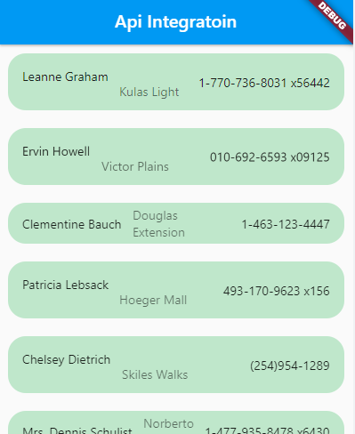

# Flutter Dummy API Integration

A Flutter project demonstrating how to effectively integrate, consume, and manage RESTful APIs. Based on the project structure, this application fetches external weather data and manages it using a clean separation of concerns between Models and Controllers.

## 🖼️ Screenshots

<p align="center">
  
</p>

## 📂 Project Architecture

This project follows a structured architectural pattern to keep UI logic separate from business logic and data modeling:

```text
lib/
├── Controller/
│   └── homeController.dart  # Handles API calls, business logic, and state management
├── Model/
│   └── homeModel.dart       # Data classes and JSON serialization for the API response
├── Screen-Pic/              # UI Reference Screenshots
│   └── Capture.PNG
└── main.dart                # Application entry point and UI view
